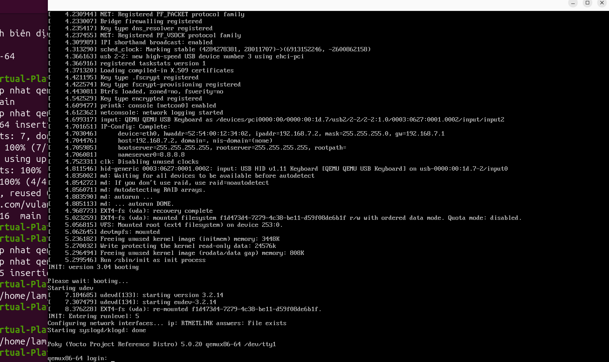

# Kết Quả Chạy Mô Phỏng QEMU - Character Device Driver

- **Hệ điều hành:** Poky (Yocto Project Reference Distro) 5.0.21
- **Target Machine:** qemux86-64
- **Module:** `my_driver` (`/dev/my_driver`)

## Minh chứng kết quả chạy thực nghiệm trên QEMU

